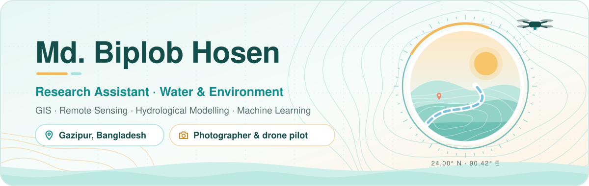
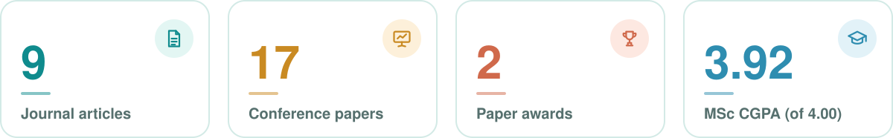
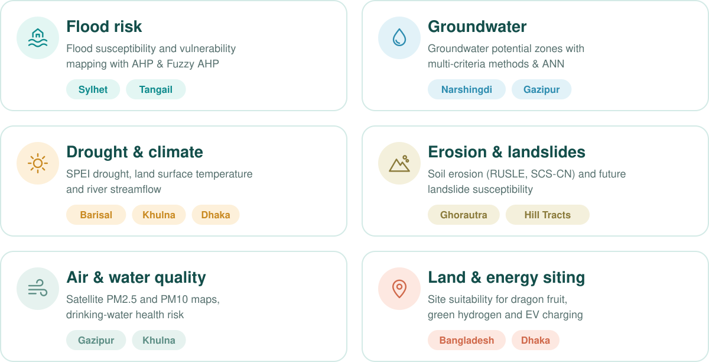
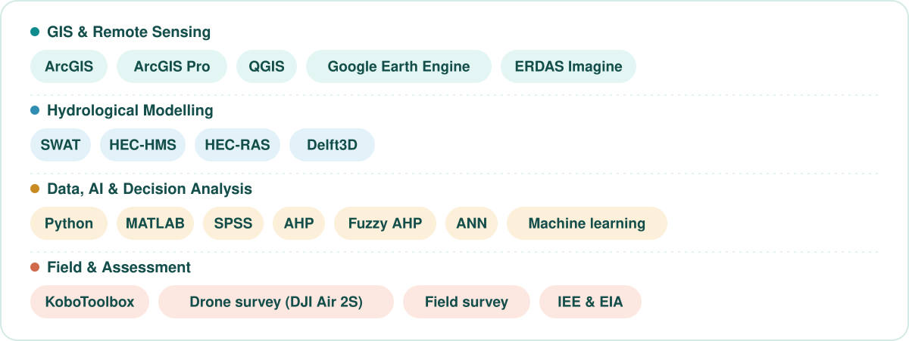

  

  
  
  
   
  
  
  

## Hello, I'm Biplob

I'm a water and environmental researcher from Bangladesh. I turn satellite images, climate records and field surveys into maps that show where floods, droughts, erosion and water stress hit hardest, so that planners can act early. Away from the desk, I'm out with a camera or a drone, photographing the same rivers and fields I study.

  

### Right now

- 🔬 **Research Assistant** at the Institute of Water & Environment (IWE), DUET
- 🌿 **Lead Consultant, Environmental Research** at BlueGreen Research and Consultancy (BGRC)
- 🎓 Finishing my **MSc in Water and Environmental Management** at DUET
- 🛠️ Building a **Raster Downscaling Tool** in Python: it trains and compares machine-learning models, then downscales a coarse raster with the best one
- 📝 Writing up new work on drought (SPEI) in Barisal and Khulna, land surface temperature in Dhaka, and EV charging station siting in Dhaka
- 🎯 Next: a **PhD** on climate-resilient water resources and flood risk reduction

## What I work on

  

## Toolbox

  

## Selected publications

1. **Hosen, M. B.**, Islam, M. R., Tahera-Tun-Humayra, U., et al. (2025). Assessing land suitability for dragon fruit cultivation in Bangladesh: A GIS-based AHP approach. *Smart Agricultural Technology*, 12, 101241. [doi:10.1016/j.atech.2025.101241](https://doi.org/10.1016/j.atech.2025.101241)
2. Aziz, M. T., Haque, A., Islam, M. R., **Hosen, M. B.**, et al. (2025). Site suitability assessment for solar-powered green hydrogen production plants: A GIS-based AHP and Fuzzy AHP approach for Bangladesh. *Renewable Energy*, 254, 123675. [doi:10.1016/j.renene.2025.123675](https://doi.org/10.1016/j.renene.2025.123675)
3. Kader, Z., Islam, M. R., Miah, M., … **Hosen, M. B.**, … & Akanda, A. S. (2026). Performance assessment of multicriteria decision making techniques and artificial neural network to predict future groundwater potential zones. *Ecological Indicators*, 183, 114619. [doi:10.1016/j.ecolind.2026.114619](https://doi.org/10.1016/j.ecolind.2026.114619)
4. Islam, M. R., **Hosen, M. B.**, Hossain, M. M., Ayejoto, D. A., & Khan, M. Y. A. (2025). Future projections of landslide susceptibility in the Hill Tracts of Bangladesh: An AHP-based approach. *Earth Systems and Environment*, 9(4), 3017–3041. [doi:10.1007/s41748-025-00776-y](https://doi.org/10.1007/s41748-025-00776-y)
5. Kundu, S., **Hosen, M. B.**, Popy, S., et al. (2026). Application of the fuzzy analytical hierarchy process for flood vulnerability assessment in Sylhet District, Bangladesh. *Discover Environment*, 4(1), 588.

<b>Show all 9 published articles</b>

 

6. Tahera-Tun-Humayra, U., Islam, M. R., **Hosen, M. B.**, et al. (2025). Groundwater potential zone mapping using analytical hierarchy process (AHP) and GIS for Narshingdi District, Bangladesh. *Environmental Challenges*, 21, 101335. [doi:10.1016/j.envc.2025.101335](https://doi.org/10.1016/j.envc.2025.101335)
7. Sharker, R., Islam, M. R., **Hosen, M. B.**, et al. (2025). GIS-based AHP approach to flood susceptibility assessment in Tangail district, Bangladesh. *Journal of Earth System Science*, 134(1), 26. [doi:10.1007/s12040-024-02480-3](https://doi.org/10.1007/s12040-024-02480-3)
8. Miah, M., Islam, M. R., Imran, H. M., … **Hosen, M. B.**, … & Hasan, M. (2025). Assessing soil erosion in the Ghorautra River Basin of Bangladesh: Using SCS-CN and RUSLE methods within the GIS-RS framework. *Journal of the Indian Society of Remote Sensing*, 53(12), 4383–4403. [doi:10.1007/s12524-025-02276-y](https://doi.org/10.1007/s12524-025-02276-y)
9. Bhowmik, D., Kader, Z., **Hosen, M. B.**, & Hossain, S. (2025). Exploring socioeconomic vulnerability and natural disasters impacts on water access in Southwestern Bangladesh. *DYSONA – Applied Science*, 6(1), 186–199. [doi:10.30493/das.2024.483646](https://doi.org/10.30493/das.2024.483646)

🏆 **Presenting Paper Award**, ICSHSD 2025, DUET, for a study of drinking water quality and health risk along the Modhumoti River 
🏆 **Presenting Paper Award**, IICASD 2024, DUET, for comparing AHP and Fuzzy AHP in selecting solid waste disposal sites in Barishal Division

## Experience

**Lead Consultant, Environmental Research** · BlueGreen Research and Consultancy (BGRC) · *2025 – present* 
GIS and remote sensing, hydrological modelling, IEE and EIA, and flood and drought risk.

**Research Assistant** · Institute of Water & Environment (IWE), DUET · *2024 – present* 
Led data collection, analysis and final reporting for two UGC-funded research projects: EV charging station siting in Dhaka District with AHP, Fuzzy AHP and ANN (2024–25), and water security in the Shitalakshya River Basin through blue and green water footprints (2025–26).

**Kuakata Sea Beach erosion reduction project** · IWFM, BUET (GCA-funded) · *2024 – 2025* 
Fieldwork on beach erosion, and a video documentary on the project for GCA.

## Education & training

**MSc in Water and Environmental Management** · Dhaka University of Engineering & Technology (DUET), Gazipur 
CGPA 3.92 / 4.00 · thesis in progress

**BSc (Hons) in Environmental Science and Disaster Management** · Gopalganj Science and Technology University 
Thesis: effects of saline water intrusion on agriculture in Gobra Union, Gopalganj (with field survey)

**Training:** Basic Python, 60 hours, IICT, DUET (2026) · Numerical Modelling, AI and GIS Technology (2023) · Application of GIS and Remote Sensing in Research (2022)

## Behind the camera

I founded **DUET_ps**, the DUET Photographic Society, and served as its Chief Instructor (2024–25). I'm now its Advisor (2025–present). I shoot landscapes, birds, flowers and foggy mornings on a **Canon EOS 77D**, and fly a **DJI Air 2S** for aerial photography and drone surveys.

- Member, GSTU Photographic Society (2018–2023)
- Environmental Secretary and Photography Secretary, Rangpur Divisional Student Association (RDSA), GSTU
- Photographer, Green Voice (GSTU branch) · Convener, Green Voice Ranisankail Upazila branch

  
  
  

 

  

